# Web Nabati Bintang Dwi R_24552011305 TIF RP 24B CID


Repository ini berisi **Project 1** (Website Nabati) dan **Project 2** (CRUD API) dalam satu repository.

## Project 1 - Website Nabati

Halaman: Beranda, Detail Informasi, Login, Registrasi, Menu Utama (setelah login).
Fitur: Bootstrap 5, validasi login memakai `if / else if / else` di `frontend/js/app.js`, footer di semua halaman.


### Screenshot
| Halaman | Screenshot |
|---|---|
| Beranda | 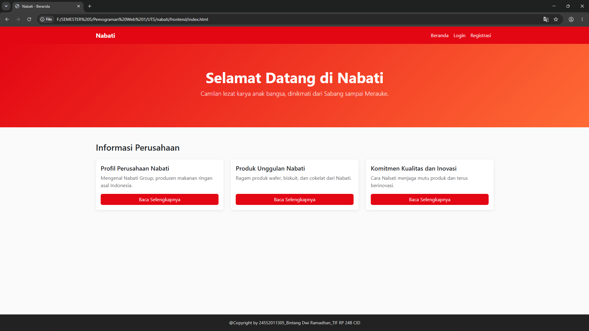 |
| Login | 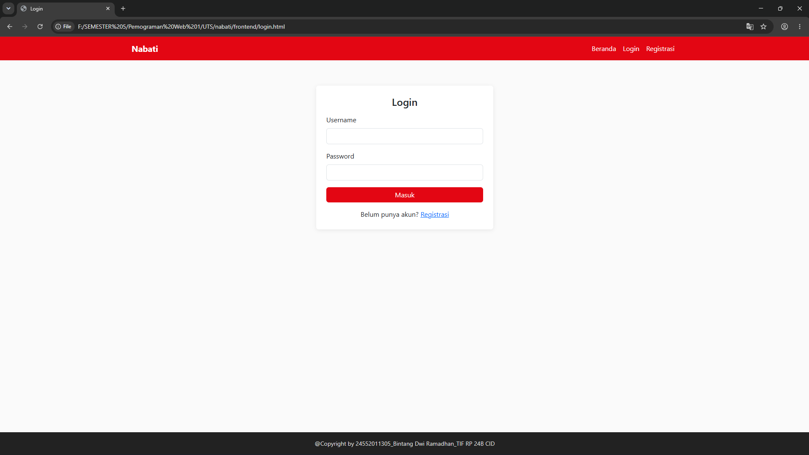 |
| Registrasi | 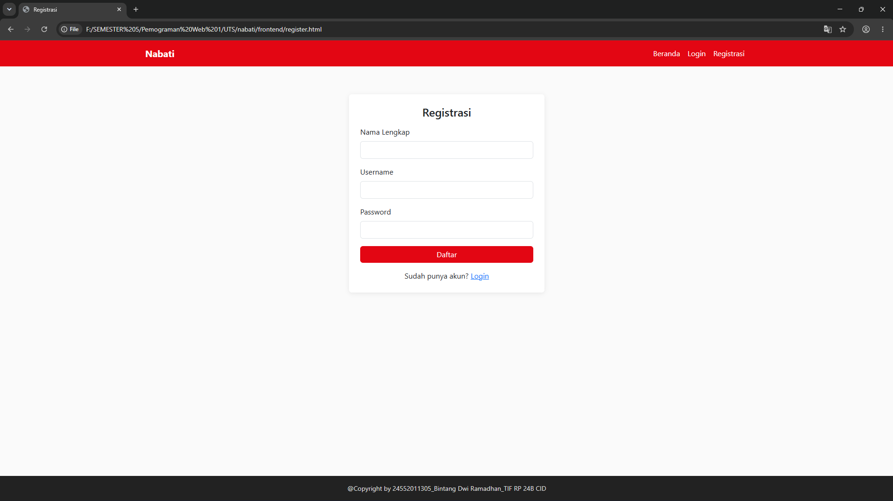 |
| Menu Utama | 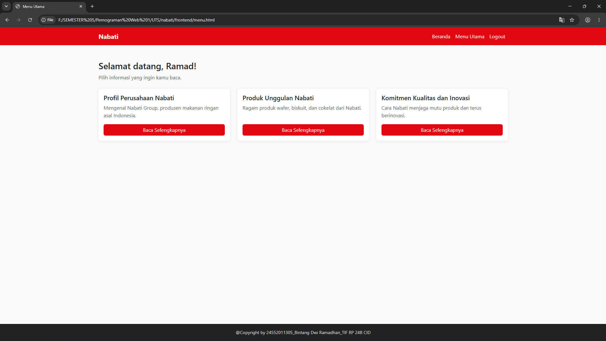 |
| Detail Beranda | 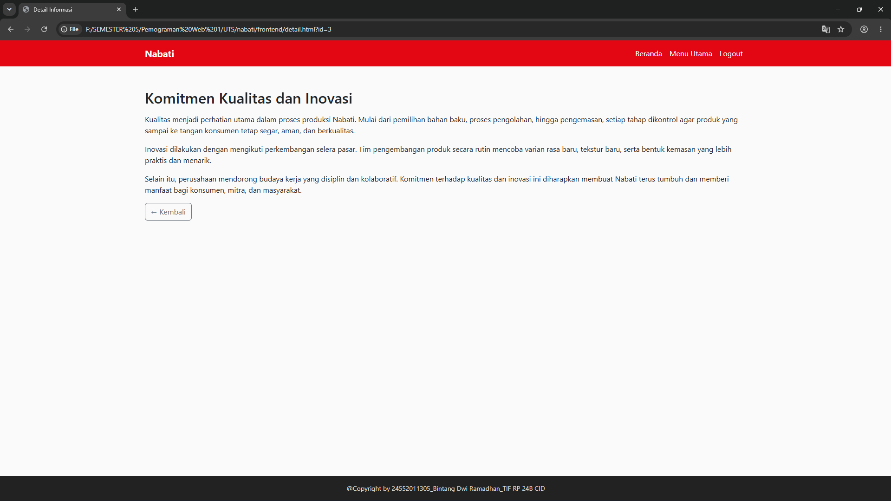 |
| Detail Beranda | 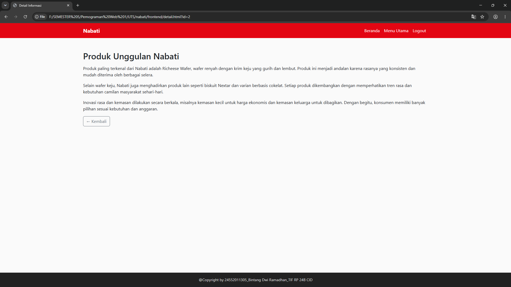 |
| Detail Beranda | 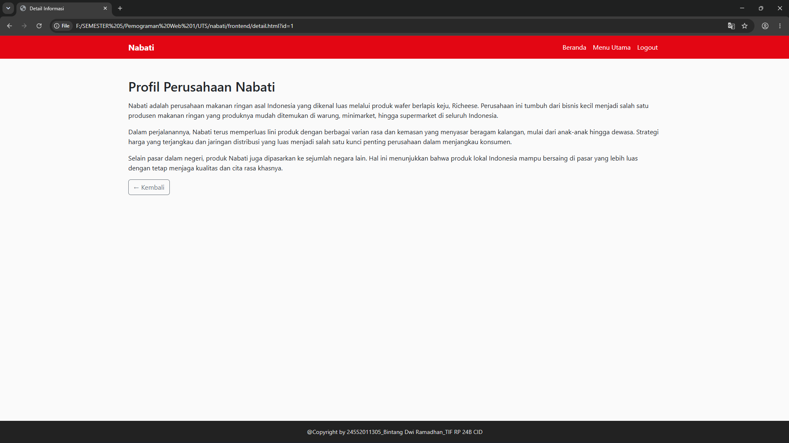 |

## Project 2 - CRUD API

| Method | Endpoint | Fungsi |
|---|---|---|
| GET | /api/informasi | Ambil semua data |
| GET | /api/informasi/:id | Ambil satu data |
| POST | /api/informasi | Tambah data |
| PUT | /api/informasi/:id | Ubah data |
| DELETE | /api/informasi/:id | Hapus data |

Contoh body POST/PUT (JSON):
```json
{ "judul": "Sejarah Nabati", "ringkasan": "Perjalanan Nabati", "isi": ["Paragraf 1", "Paragraf 2", "Paragraf 3"] }
```
## Tutorial Pengujian dengan Bruno

1. **Install Bruno** dari https://www.usebruno.com/downloads, lalu buka aplikasinya.
2. **Jalankan server** dulu: `cd backend && npm start`.
3. **Import collection** (cara cepat): klik *Open Collection* -> pilih folder `bruno/` di repository ini. Lima request sudah tersedia.
   - Atau buat manual: *Create Collection* -> nama `Nabati API` -> *New Request*.
4. **GET All**: method GET, URL `http://localhost:3000/api/informasi`, klik **Send** (Ctrl+Enter). Hasil: `200 OK` dan 3 data.
5. **GET By Id**: URL `http://localhost:3000/api/informasi/1`. Hasil `200 OK`; id yang tidak ada (misal 99) menghasilkan `404`.
6. **POST (Create)**: method POST, URL `http://localhost:3000/api/informasi`. Pada Tab **Body** -> pilih **JSON** -> isi contoh body di atas -> Send. Hasil: `201 Created`.
7. **PUT (Update)**: method PUT, URL `http://localhost:3000/api/informasi/1`, Body JSON berisi field yang diubah -> Send. Hasil: `200 OK`.
8. **DELETE**: method DELETE, URL `http://localhost:3000/api/informasi/1` -> Send. Hasil: `200 OK`.
9. **Ambil screenshot** tiap request (terlihat URL, method, body, response, status), simpan ke folder `screenshots/`.

### Hasil Uji Bruno
| Request | Screenshot |
|---|---|
| GET All | 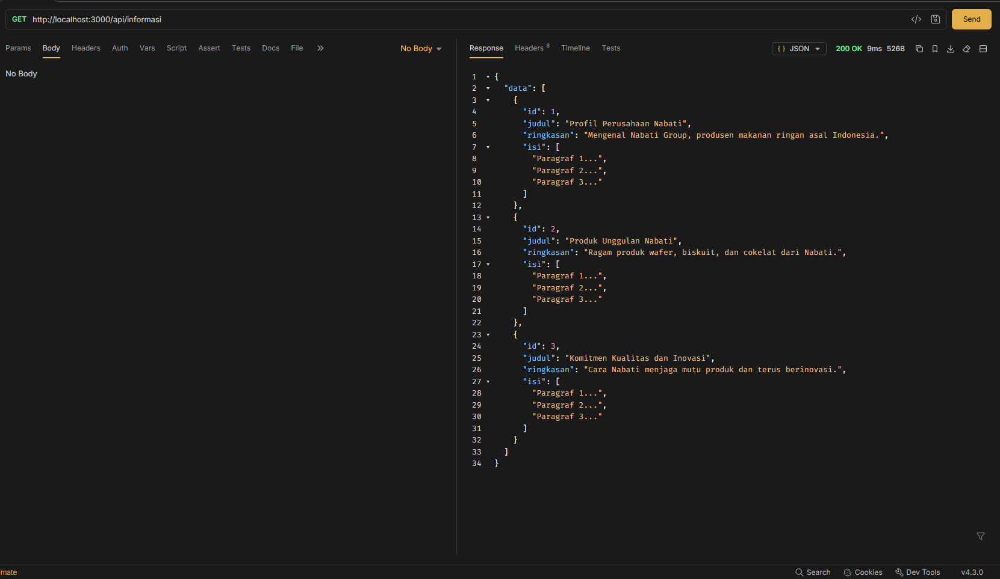 |
| GET By Id | 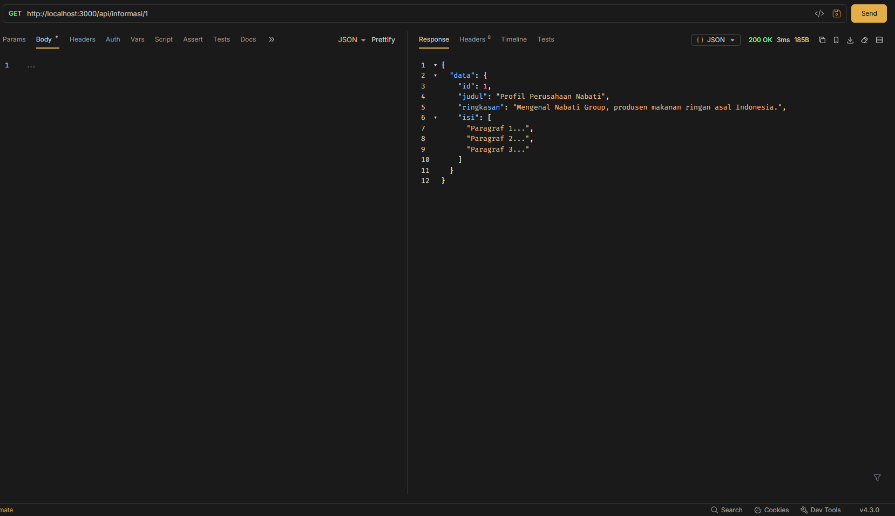 |
| POST Create | 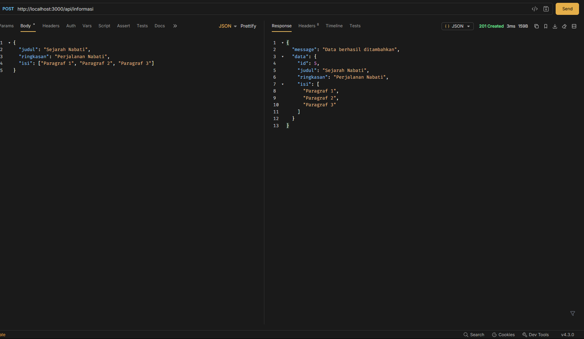 |
| PUT Update |  |
| DELETE | 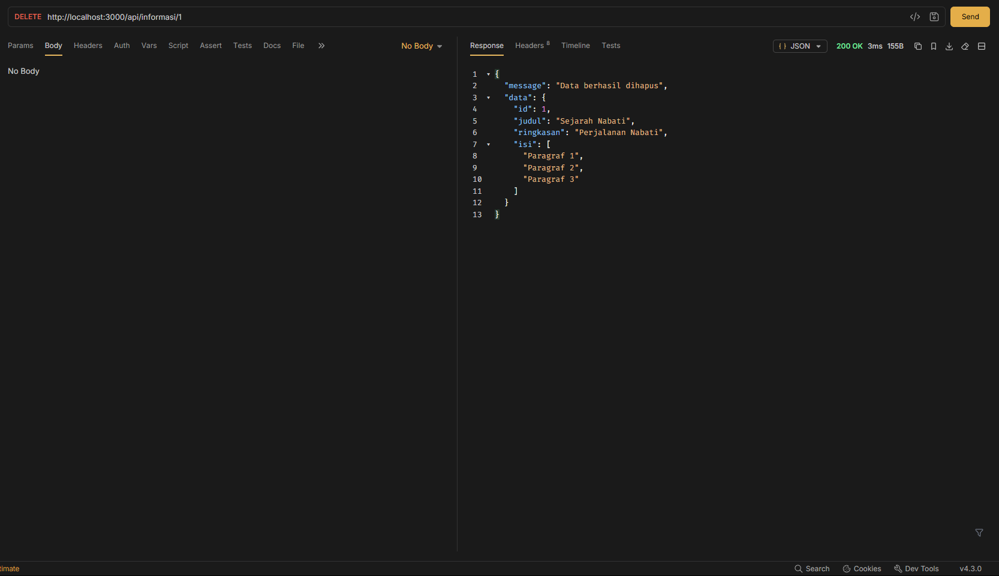 |
---
Dibuat oleh: 24552011305_Bintang Dwi Ramadhan_TIF RP 24B CID
